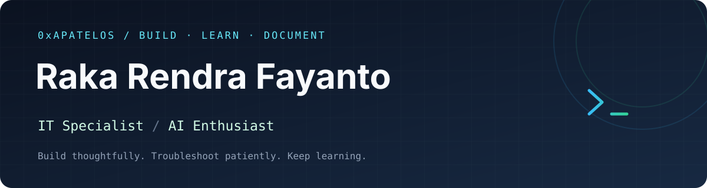

  <a href="https://0xapatelos.github.io/"><b>Portfolio</b></a> &nbsp; · &nbsp;
  <a href="https://www.linkedin.com/in/raka-rendra-724929279/"><b>LinkedIn</b></a> &nbsp; · &nbsp;
  <a href="mailto:rakaarendraa@gmail.com"><b>Email</b></a>

## Technology that solves real problems.

Hi, I'm **Raka**, based in Surakarta, Indonesia. My focus is **IT Specialist & AI Enthusiast**: understanding how systems work, investigating problems, and exploring practical ways to automate repetitive work.

I build web projects and am strengthening my foundations in IT operations and Python-based AI workflows. I value clear documentation, reproducible setup steps, and explaining what a project does **and where its limits are**.

### Selected public work

| Project | What to look at | Stack |
| :--- | :--- | :--- |
| **[Portfolio & Blog ↗](https://github.com/0xApatelos/0xApatelos.github.io)** | Personal website and writing. Explore the components, GitHub API integration, and project documentation. **[Open website](https://0xapatelos.github.io/)** | React · TypeScript · Vite · Tailwind CSS |
| **[Newton–Raphson Calculator ↗](https://github.com/0xApatelos/Newton-Rhapson-Calculator)** | An OOP coursework project: Java desktop UI demonstrating a Newton–Raphson update for a fixed polynomial. | Java · Swing · NetBeans / Ant |

### Learning & practice

- **IT foundations:** troubleshooting, operating systems, networking, and system administration.
- **AI exploration:** Python, prompt design, text analysis, and integrating AI into practical workflows.
- **Supporting tools:** Git, GitHub, command line, and web development.

These are learning and practice areas, not a list of professional certifications.

### Next builds — planned, not shipped

- **IT Support Homelab:** a small documented environment with a network diagram, incident scenarios, and troubleshooting runbooks.
- **System Health Monitor:** a script that checks services, storage, and connectivity, with example logs and failure tests.
- **AI Helpdesk Assistant:** answers grounded in a small knowledge base, with source citations and a documented evaluation set.

I'll link these here when public repositories and reproducible demos are available.

---

**Let's connect:** [LinkedIn](https://www.linkedin.com/in/raka-rendra-724929279/) or [rakaarendraa@gmail.com](mailto:rakaarendraa@gmail.com).

Education

Informatics studies at Universitas Muhammadiyah Surakarta, started in 2022. Currently on academic leave; the degree is not yet completed. Continuing independent learning in IT and AI.

